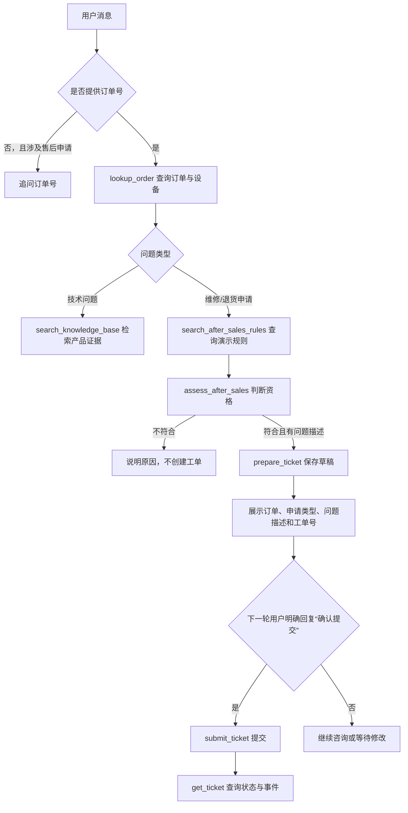

# 网络设备售后咨询与工单处理 Agent

基于 **LangGraph + DeepSeek + MCP** 的多工具对话 Agent，面向网络设备售后场景。它把「产品知识检索 → 订单查询 → 售后规则判断 → 工单草稿 → 用户确认 → 提交与进度查询」组织成一条可执行、可追踪、可恢复的业务链路，同时保留通用计算、时间查询和知识检索能力。

> **数据声明**
> 项目中的订单、售后规则和工单均为本地演示数据，不代表任何厂商的正式售后政策或法律结论。`submitted` 只表示本地演示工单等待人工审核，不表示已经退款、维修、寄修或向厂商提交申请。

## 项目定位

本仓库是双项目体系中的 **项目二（Agent 编排与售后业务）**：

| 项目 | 职责 |
| --- | --- |
| 项目一：产品知识检索服务 | 负责文档解析、Embedding、向量检索、BM25、RRF、重排，并以 HTTP 服务暴露 `POST /retrieve` |
| 项目二：本仓库 | 负责 Agent 决策、工具编排、订单与工单业务、确认边界、会话持久化和验收评估，通过 HTTP 调用项目一获取产品证据 |

项目二不重复实现向量库和重排逻辑。未启动项目一或未配置检索服务时，可将 `RAG_BACKEND` 切换为 `demo`，使用本地关键词检索演示数据。

## 功能特性

- **LangGraph Agent 循环**：`plan → llm → tools → llm → …` 条件路由，模型决定是否调用工具，程序负责实际执行。
- **多工具执行**：本地函数调用与 MCP stdio 两种传输方式；MCP 工具在启动时通过 `tools/list` 动态发现。
- **售后业务闭环**：订单查询、演示规则检索、资格判断、工单草稿、服务端确认提交、工单进度与事件查询。
- **产品知识检索**：本地适配器调用项目一混合检索与重排服务，保留证据、来源和设备范围。
- **设备范围约束**：已查询订单的型号、硬件版本、地区会自动带入检索；模型传入冲突参数会被拒绝。
- **服务端安全边界**：客户身份、会话归属和提交确认由服务端注入与校验，模型无法通过参数绕过。
- **持久化会话**：进程内使用 LangGraph `InMemorySaver`，SQLite 保存完成轮次、工具记录和业务上下文，服务重启后可继续同一 `thread_id`。
- **可观测执行记录**：每次工具调用记录来源、`call_id`、状态、尝试次数、耗时和业务状态；`plan` 与 `tool_trace` 按 `call_id` 对应。
- **离线与在线分离的评估**：确定性离线规则验证执行框架；配置 API Key 后才运行真实模型在线验收。

## 多 Agent 版本

在单 Agent 之外，项目提供了一个多 Agent 实现（`POST /multi-agent/chat`），把一个模型拿全部工具，拆成按职责隔离权限的几个组件：

- **意图路由器**：只调用一次模型，判断用户想做什么。订单号和设备范围以用户原话为准，由程序再校验一遍；信息缺失时先追问，不启动任何子 Agent。
- **Dynamic Supervisor**：按任务类型只开放对应的子 Agent，并检查调用顺序和完成条件。
- **订单 / 知识 / 工单三个子 Agent**：各自只能使用自己的工具。工单 Agent 在对话中只能创建草稿，正式提交必须经过人工审批接口（LangGraph `interrupt()`）。审批状态保存在 SQLite 中，服务重启后可以继续处理。
- **可观测**：每个请求都返回路由判断、工具记录，以及 LLM 调用次数和 token 用量。

单 Agent 的 `/chat` 保持不变，两者可以用同一批用例对比。架构、设计取舍和评测方法见 [`docs/multi-agent.md`](docs/multi-agent.md)。

## 业务流程



流程约束：

- 单纯技术咨询或订单查询不会创建工单。
- 维修与退货未明确时先澄清用户意图。
- 资格判断只依据订单记录、日期和版本化演示规则，模型不能自行计算或猜测。
- 草稿状态为 `draft`，只有用户在当前轮明确确认后才变为 `submitted`。
- 工单查询必须调用 `get_ticket` 读取 SQLite，不能根据历史回答猜测进度。

## 系统架构

```text
┌─────────────────────────────────────────────────────────────┐
│                     FastAPI / CLI 入口                       │
│                 POST /chat · GET /tools · GET /threads       │
└──────────────────────────┬──────────────────────────────────┘
                           │
┌──────────────────────────▼──────────────────────────────────┐
│                   AgentGraph（LangGraph）                    │
│                                                             │
│   plan ──► llm ──► route_after_llm ──► tools ──► llm ──► …  │
│              │                              │               │
│              └──────────── 无 tool_calls ───┴──► END         │
└───────┬──────────────────────┬──────────────────────┬───────┘
        │                      │                      │
        ▼                      ▼                      ▼
┌───────────────┐    ┌──────────────────┐    ┌────────────────┐
│ LLMClient     │    │ 工具执行层        │    │ 持久化层        │
│ DeepSeek API  │    │ local / MCP stdio │    │ InMemorySaver  │
│ 无 Key 时离线  │    │ 售后工具 / 检索   │    │ SQLite sessions │
└───────────────┘    └────────┬─────────┘    │ SQLite support  │
                              │              └────────────────┘
                    ┌─────────┴──────────┐
                    ▼                    ▼
          ┌──────────────────┐   ┌──────────────────┐
          │ 项目一 RAG 服务   │   │ MCP Server        │
          │ POST /retrieve    │   │ calculate / time  │
          └──────────────────┘   └──────────────────┘
```

### 核心组件

| 组件 | 文件 | 职责 |
| --- | --- | --- |
| HTTP 入口 | `app/api.py` | 请求校验、UTF-8 响应、异常映射 |
| Agent 图 | `app/graph.py` | 状态定义、节点、条件路由、工具执行、上下文更新 |
| 模型客户端 | `app/llm_client.py` | DeepSeek Function Calling、消息格式转换、离线规则回退 |
| 执行计划 | `app/planner.py` | 根据真实 `tool_calls` 增量记录步骤并结算状态 |
| 本地工具 | `app/tools.py` | `calculate`、`get_current_time` |
| MCP 客户端 | `app/mcp_client.py` | 同步适配真实 MCP stdio 子进程 |
| MCP 注册表 | `app/mcp_registry.py` | 动态发现工具 schema 并生成调用函数 |
| MCP 服务端 | `app/mcp_server.py` | 以 stdio 暴露计算和时间工具 |
| 知识检索 | `app/rag_tool.py` | 项目一 HTTP 适配器与本地关键词演示后端 |
| 售后工具 | `app/support_tools.py` | 6 个业务工具的 Schema、参数校验和服务端上下文注入 |
| 售后业务 | `app/support_service.py` | 资格判断、草稿、确认提交、状态查询 |
| 售后存储 | `app/support_store.py` | 订单、工单、事件表；事务、唯一草稿键、幂等提交 |
| 会话存储 | `app/storage.py` | SQLite 会话表、旧表迁移、业务上下文保存 |
| 通用评估 | `app/evaluation.py` | 8 题执行框架验收 |
| 售后评估 | `app/support_evaluation.py` | 9 个业务流程验收 |
| HTTP 服务检查 | `app/check_support_service.py` | 对真实 Uvicorn 服务执行多轮工单流程检查 |
| CLI | `app/cli.py` | 命令行对话入口 |

## 技术栈

| 类别 | 技术 |
| --- | --- |
| 语言 | Python 3.11+（已验证 3.11 / 3.12） |
| Agent 编排 | LangGraph、LangChain Core |
| 模型 | DeepSeek（OpenAI 兼容接口，`temperature=0`） |
| Web 服务 | FastAPI、Uvicorn |
| 工具协议 | MCP（stdio transport） |
| 数据存储 | SQLite |
| HTTP 客户端 | httpx（禁用环境代理，避免本地检索误走系统代理） |
| 测试 | pytest |

## 目录结构

```text
agent-assistant-v1/
├── app/
│   ├── api.py                     # FastAPI 入口与接口校验
│   ├── cli.py                     # 命令行对话
│   ├── config.py                  # 环境变量与路径配置
│   ├── graph.py                   # LangGraph Agent、工具执行、确认边界
│   ├── llm_client.py              # 在线模型与离线规则
│   ├── messages.py                # 工具调用提取
│   ├── planner.py                 # 增量执行步骤
│   ├── tools.py                   # 本地计算与时间工具
│   ├── mcp_client.py              # MCP stdio 同步适配器
│   ├── mcp_registry.py            # MCP 工具动态注册
│   ├── mcp_server.py              # MCP 工具服务端
│   ├── rag_tool.py                # 项目一检索适配器 / demo 后端
│   ├── storage.py                 # SQLite 会话存储
│   ├── support_tools.py           # 售后工具 Schema 与调用封装
│   ├── support_service.py         # 售后业务规则
│   ├── support_store.py           # 订单、工单、事件 SQLite
│   ├── support_offline.py         # 无 Key 时的售后演示路由
│   ├── evaluation.py              # 通用 Agent 验收
│   ├── evaluation_cases.py        # 通用验收用例
│   ├── support_evaluation.py      # 售后流程验收
│   ├── check_support_service.py   # 真实 HTTP 服务检查
│   ├── configure_support.py       # 写入业务配置并保留已有凭据
│   ├── usage.py                   # 按请求统计 LLM 调用与 token
│   └── multi_agent/               # 多 Agent 版本（见 docs/multi-agent.md）
│       ├── intent_router.py       # LLM 意图路由 + 程序校验
│       ├── dynamic_supervisor.py  # 按任务类型调度子 Agent
│       ├── supervisor_tools.py    # 子 Agent 调用封装与订单验证状态
│       ├── order_agent.py         # 只读订单与资格 Agent
│       ├── knowledge_agent.py     # 设备知识检索 Agent
│       ├── ticket_agent.py        # 工单草稿 Agent
│       ├── ticket_approval_graph.py # interrupt 人工审批图
│       ├── ticket_approval_api.py # 审批 HTTP 接口
│       ├── approval_store.py      # 审批会话与检查点的 SQLite 持久化
│       └── http_router.py         # /multi-agent/chat
├── data/
│   ├── knowledge.md               # demo 知识库
│   ├── demo_orders.json           # 演示订单
│   ├── demo_after_sales_rules.json# 版本化演示售后规则
│   └── eval/                      # 路由开发集/测试集、端到端对比用例
├── scripts/                       # 在线评测与检查脚本（python -m scripts.<名称>）
├── docs/                          # 设计说明、演示用例与测试报告
├── tests/                         # pytest 回归测试
├── requirements.txt
├── Dockerfile
├── .env.example
└── README.md
```

## 快速开始

### 1. 环境要求

- Python 3.11 或 3.12
- 可选：项目一 RAG 服务运行在 `http://127.0.0.1:8001`
- 可选：DeepSeek API Key。没有 Key 时可以使用离线规则演示，但在线评估会拒绝运行

### 2. 安装依赖

Windows PowerShell：

```powershell
python --version
python -m venv .venv
.\.venv\Scripts\Activate.ps1
python -m pip install -r requirements.txt
```

如果 PowerShell 不允许执行激活脚本，可以直接使用虚拟环境解释器：

```powershell
.\.venv\Scripts\python.exe -m pip install -r requirements.txt
.\.venv\Scripts\python.exe -m pytest -q
```

macOS / Linux：

```bash
python3 -m venv .venv
source .venv/bin/activate
python -m pip install -r requirements.txt
```

### 3. 创建配置

```powershell
Copy-Item .env.example .env
```

然后编辑 `.env`。没有启动项目一时，建议先设置：

```dotenv
RAG_BACKEND=demo
```

有项目一服务并配置了 Key 时：

```dotenv
DEEPSEEK_API_KEY=填入自己的Key
DEEPSEEK_BASE_URL=https://api.deepseek.com
DEEPSEEK_MODEL=deepseek-flash
TOOL_TRANSPORT=local
MAX_STEPS=10
TOOL_TIMEOUT_SECONDS=45
RAG_BACKEND=project1
RAG_SERVICE_URL=http://127.0.0.1:8001
RAG_TIMEOUT_SECONDS=30
SUPPORT_MODE=demo
SUPPORT_DB=data/support_demo.db
SESSION_DB=data/agent_sessions.db
DEMO_CUSTOMER_ID=demo-customer-001
```

模型名以账号实际可用配置为准。

### 4. 启动服务

```powershell
python -m uvicorn app.api:app --reload
```

- 接口文档：<http://127.0.0.1:8000/docs>
- 健康检查：<http://127.0.0.1:8000/health>
- CLI：`python -m app.cli`，输入 `exit` 退出

说明：

- 修改 `.env` 后需要重启服务。
- `TOOL_TRANSPORT=mcp` 时，MCP 子进程由程序自动启动，不需要另开终端运行 `app.mcp_server`。
- 使用 `RAG_BACKEND=project1` 时，需要先启动项目一；检索服务不可用不会自动回退到 demo，而是返回明确的连接错误。

### 5. 业务配置辅助命令

`app/configure_support` 可以只更新业务接入参数，保留已有 API Key、模型名和其他配置，并在 `data/private_backups/` 备份原 `.env`：

```powershell
# 只检查将修改哪些配置
python -m app.configure_support

# 应用配置
python -m app.configure_support --apply
```

该命令会写入：`RAG_BACKEND=project1`、`RAG_SERVICE_URL`、`SUPPORT_MODE=demo`、`SUPPORT_DB`、`DEMO_CUSTOMER_ID`、`MAX_STEPS=10`、`TOOL_TIMEOUT_SECONDS=45`、`RAG_TIMEOUT_SECONDS=30`。

## 配置项

| 变量 | 默认值 | 说明 |
| --- | --- | --- |
| `DEEPSEEK_API_KEY` | 空 | 为空时启用离线规则演示；在线评估会被拒绝 |
| `DEEPSEEK_BASE_URL` | `https://api.deepseek.com` | OpenAI 兼容接口地址 |
| `DEEPSEEK_MODEL` | `deepseek-flash` | 模型名称 |
| `MAX_STEPS` | `6` | 模型调用步数上限；达到后安全停止 |
| `TOOL_TIMEOUT_SECONDS` | `15` | 单次工具等待超时（秒） |
| `TOOL_TRANSPORT` | `local` | `local` 或 `mcp`；`.env.example` 未显式列出，可按需添加 |
| `RAG_BACKEND` | `project1` | `project1` 调用项目一；`demo` 使用本地关键词检索 |
| `RAG_SERVICE_URL` | `http://127.0.0.1:8001` | 项目一服务地址 |
| `RAG_TIMEOUT_SECONDS` | `30` | 检索请求超时 |
| `SUPPORT_MODE` | `demo` | `demo` 启用售后工具；`off` 关闭业务模块 |
| `SUPPORT_DB` | `data/support_demo.db` | 演示订单与工单数据库 |
| `SESSION_DB` | `data/agent_sessions.db` | 会话持久化数据库；`.env.example` 未显式列出 |
| `DEMO_CUSTOMER_ID` | `demo-customer-001` | 未传 `customer_id` 时使用的演示客户 |
| `APPROVAL_DB` | `data/ticket_approvals.db` | 工单审批会话与 LangGraph 检查点；服务重启后待审批工单仍可处理 |
| `ENABLE_DEMO_TICKET_APPROVALS` | 未设置 | 设为 `1` 时启用 `/ticket-approvals` 演示审批接口 |
| `APPROVAL_DEMO_TOKEN` | 空 | 审批接口的演示令牌，至少 32 个字符，通过 `X-Approval-Token` 请求头传入 |
| `APPROVAL_DEMO_THREAD_ID` | 空 | 审批接口绑定的演示会话 |
| `KNOWLEDGE_PATH` | `data/knowledge.md` | 知识库路径配置；当前图内 demo 检索固定读取 `data/knowledge.md`，该变量尚未接入工具 |

数据库文件、`.env`、虚拟环境和报告目录均已加入 `.gitignore`。

## HTTP API

| 方法 | 路径 | 用途 |
| --- | --- | --- |
| `GET` | `/health` | 进程健康状态、是否在线、RAG 后端、业务模式和工具传输；`online` 只表示已配置模型客户端，不代表凭据一定可用 |
| `GET` | `/tools` | 当前已注册的工具名称 |
| `GET` | `/threads` | SQLite 中已保存的会话列表 |
| `GET` | `/demo/orders` | 默认演示客户的示例订单；业务模块关闭时返回 404 |
| `POST` | `/chat` | 单 Agent：执行一轮对话 |
| `POST` | `/multi-agent/chat` | 多 Agent：不传 `task_type` 时由意图路由器判断，详见 [`docs/multi-agent.md`](docs/multi-agent.md) |
| `POST` | `/ticket-approvals` | 为草稿工单发起人工审批（需启用演示审批接口） |
| `GET` | `/ticket-approvals/{id}` | 查询审批状态 |
| `POST` | `/ticket-approvals/{id}/decision` | 批准或拒绝；批准后重新校验并提交 |

`/chat` 和 `/multi-agent/chat` 的响应都包含 `usage` 字段：本次请求的 LLM 调用次数和 token 用量。如果模型服务没有返回用量，`tokens_complete` 为 `false`。

### POST /chat 请求

```json
{
  "message": "查询订单 DEMO-1001 的状态和设备信息",
  "thread_id": "support-demo-001",
  "customer_id": "demo-customer-001"
}
```

| 字段 | 必填 | 说明 |
| --- | --- | --- |
| `message` | 是 | 1–4000 字符，不能为空白 |
| `thread_id` | 否 | 会话标识，默认 `default`，最长 100 字符 |
| `customer_id` | 否 | 演示客户标识；不传时使用 `DEMO_CUSTOMER_ID`。同一会话不能中途换绑客户 |

### POST /chat 响应

```json
{
  "answer": "订单 DEMO-1001 已交付，设备为 Archer AX10 V1 US。",
  "thread_id": "support-demo-001",
  "tool_trace": [
    {
      "tool": "lookup_order",
      "source": "local",
      "call_id": "call_xxx",
      "status": "success",
      "attempts": 1,
      "latency_ms": 12.34,
      "business_status": "found",
      "arguments": {"order_id": "DEMO-1001"}
    }
  ],
  "errors": [],
  "message_count": 2,
  "plan": [
    {"id": 1, "action": "接收用户问题", "status": "completed"},
    {"id": 2, "action": "执行工具：lookup_order", "status": "completed"},
    {"id": 3, "action": "生成最终回答", "status": "completed"}
  ],
  "status": "completed",
  "business_context": {
    "customer_id": "demo-customer-001",
    "order_id": "DEMO-1001",
    "product_scope": {
      "product_model": "Archer AX10",
      "hardware_version": "V1",
      "region": "US"
    }
  },
  "business_mode": "demo",
  "online": true
}
```

`status` 取值：

| 值 | 含义 |
| --- | --- |
| `completed` | 正常完成 |
| `completed_with_errors` | 完成，但工具执行过程中有错误记录 |
| `stopped` | 达到 `MAX_STEPS`，安全停止 |

`tool_trace` 中检索工具还会记录 `retrieval_backend`、`retrieval_status`、`evidence_count`、`resolved_scope`；业务工具会记录 `business_status`、`arguments`，创建或提交工单时还会记录 `ticket_id`。

HTTP 错误：

| 状态码 | 场景 |
| --- | --- |
| `409` | 业务参数或会话绑定错误，例如同一 `thread_id` 换绑客户 |
| `422` | 请求字段校验失败 |
| `503` | Agent 执行失败；响应不会假定工单已提交 |

### PowerShell 调用示例

```powershell
$threadId = "support-" + ([guid]::NewGuid()).ToString("N")
$body = @{
  message = "我的示例订单是 DEMO-1001，设备无法开机。请查询订单和演示维修规则，判断资格；符合时准备工单草稿，先展示给我核对，不要提交。"
  thread_id = $threadId
} | ConvertTo-Json

$result = Invoke-RestMethod `
  -Uri "http://127.0.0.1:8000/chat" `
  -Method Post `
  -ContentType "application/json; charset=utf-8" `
  -Body ([System.Text.Encoding]::UTF8.GetBytes($body)) `
  -TimeoutSec 180

$result | ConvertTo-Json -Depth 20
```

第二轮使用同一 `thread_id` 发送 `确认提交`，第三轮发送 `查询工单进度`。

## 售后业务说明

### 演示客户与订单

默认客户：`demo-customer-001`。

| 订单号 | 客户 | 设备 | 状态 | 交付时间（首次建库时生成） |
| --- | --- | --- | --- | --- |
| `DEMO-1001` | `demo-customer-001` | Archer AX10 / V1 / US | 已交付 | 3 天前 |
| `DEMO-1002` | `demo-customer-001` | Archer AX20 / V1 / US | 已交付 | 90 天前 |
| `DEMO-1003` | `demo-customer-001` | Archer AX10 / V1 / US | 已交付 | 400 天前 |
| `DEMO-1004` | `demo-customer-002` | Archer AX20 / V1 / US | 已交付 | 2 天前 |
| `DEMO-1005` | `demo-customer-001` | Archer AX10 / V1 / US | 已发货、未交付 | — |

交付日期在第一次创建 `SUPPORT_DB` 时根据 `delivered_days_ago` 生成，之后重启不会重置。需要重新生成时，删除本地 `data/support_demo.db` 后重启服务。

### 演示规则

规则版本：`demo-support-v1`，类型标记为 `fictional_demo_policy`。

| 申请类型 | 规则 ID | 条件 |
| --- | --- | --- |
| 维修 `repair` | `DEMO-POLICY-REPAIR` | 订单已交付，且交付后不超过 365 天 |
| 退货 `return` | `DEMO-POLICY-RETURN` | 订单已交付，且交付后不超过 7 天 |

这些数字是自建演示规则，不是厂商政策。资格通过只表示可以准备演示申请，最终处理仍待人工审核。

### 业务工具

| 工具 | 作用 | 关键约束 |
| --- | --- | --- |
| `lookup_order` | 查询当前客户的订单和设备 | 只能查询当前演示客户；订单号不能编造 |
| `search_after_sales_rules` | 检索带版本的演示规则 | `service_type` 只能是 `repair` 或 `return` |
| `assess_after_sales` | 根据订单日期和规则判断资格 | 禁止模型自行计算资格 |
| `prepare_ticket` | 保存工单草稿并返回真实工单号 | 必须资格通过；问题描述必须逐字摘录用户原话 |
| `submit_ticket` | 提交当前会话草稿 | 必须匹配本轮服务端确认；不执行真实退款或维修 |
| `get_ticket` | 查询工单状态与事件 | 只能查询当前客户和会话中的工单 |

### 确认与幂等

- 只有当前轮用户消息完整匹配 `确认提交` / `确认提交工单`（可附带实际 `TKT-...` 工单号）时，服务端才会授权提交；模糊、引用、否定或历史消息中的确认都不授权。
- 模型不能通过传入布尔值、客户 ID 或工单号绕过确认；确认由 `graph.py` 在调用模型前根据原始用户消息生成。
- `prepare_ticket` 的 `issue_summary` 必须能在当前会话的用户原话中找到，否则返回 `needs_clarification`，不保存工单。
- 同一客户、会话、订单、申请类型使用唯一草稿键，重复准备会复用原工单，不会因模型改写措辞而创建多张工单。
- `submit_ticket` 使用事务和状态判断保证幂等，重复提交不会重复写入 `submitted` 事件。
- 提交前会再次校验资格和规则版本；状态或规则变化时返回 `revalidation_required`。
- 当前演示版不支持编辑或取消已保存工单，也不能把再次 `prepare_ticket` 当成修改。

## 产品知识检索

`search_knowledge_base` 有两种后端：

### project1（默认）

通过 `POST {RAG_SERVICE_URL}/retrieve` 调用项目一：

```json
{
  "question": "Wi-Fi 频繁掉线应该如何排查",
  "top_k": 3,
  "product_model": "Archer AX10",
  "hardware_version": "V1",
  "region": "US"
}
```

适配器会：

- 校验 HTTP 状态码；
- 校验响应 `backend` 为 `project1`；
- 校验每条证据包含 `content`、`source`、`chunk_id`；
- 保留项目一返回的 `resolved_scope`、`evidence_count` 等字段；
- 连接失败时抛出 `ConnectionError`，超时时抛出 `TimeoutError`，不会静默回退到 demo。

设备范围处理：

- 已通过 `lookup_order` 验证的订单，会把 `product_model`、`hardware_version`、`region` 自动带入检索。
- 模型显式传入与已验证订单不一致的设备参数时，工具会拒绝执行并返回冲突错误。
- 技术检索问题只应包含技术问题，不应混入“查询订单”“提交工单”等业务指令。

### demo

使用 `data/knowledge.md` 进行本地分词和关键词重合度排序，返回最多 `top_k` 条片段。该模式只用于离线演示和测试。

## 会话与数据持久化

| 层 | 存储 | 内容 | 生命周期 |
| --- | --- | --- | --- |
| 图状态 | LangGraph `InMemorySaver` | 运行时消息、步骤、计划、上下文 | 进程内；重启清空 |
| 会话 | SQLite `sessions` 表 | 完成的用户/助手轮次、工具记录、错误、业务上下文 | 跨进程保留 |
| 业务 | SQLite `orders` / `tickets` / `ticket_events` | 演示订单、工单、状态事件 | 跨进程保留 |

重启恢复规则：

- 新进程没有内存 checkpoint 时，从 SQLite 恢复最近 12 条用户/最终助手消息，再追加本轮问题。
- 售后模式下，已保存的业务上下文（订单、设备范围、待确认工单）会继续加载，即使进程内仍有图状态。
- 只恢复完成的对话轮次，不恢复中途执行节点，也不会重新执行历史工具调用。
- 业务工具成功后会立即保存业务上下文；即使后续模型回复失败，已保存的草稿仍可在原会话继续确认。

`thread_id` 只是会话标识，不是登录凭证或权限凭证。

## 工具执行与错误处理

### 传输方式

| `TOOL_TRANSPORT` | 计算 / 时间 | 知识检索 | 售后工具 |
| --- | --- | --- | --- |
| `local` | 进程内函数 | 本地适配器 | 本地执行 |
| `mcp` | MCP stdio 子进程 | 本地适配器 | 本地执行 |

MCP 模式启动时会：

- 通过 `tools/list` 动态发现工具并生成 Function Calling Schema；
- 检查重复工具名；
- 禁止 MCP 工具与本地 `search_knowledge_base` 冲突；
- 每次操作创建一个 stdio 会话，调用结束后关闭，不维护连接池。

### 错误与重试

| 场景 | 行为 |
| --- | --- |
| 参数错误、业务错误、MCP 工具返回错误 | 只执行一次，不重试 |
| `ConnectionError` | 最多重试两次，总尝试次数上限为 2 |
| 工具超时 | 停止等待并记录错误，不重复执行可能仍在运行的任务 |
| 未知工具 | 返回错误，不中断整个图 |
| 达到 `MAX_STEPS` | 返回 `stopped`，计划最后一步标记为 `skipped` |

超时通过线程和 `Future.result(timeout=...)` 实现，能停止等待，但无法强制终止已经运行的 Python 线程；更强的隔离或硬终止需要额外设计。

### 执行计划

`plan` 不是预先拆解的任务规划器，而是根据模型真实返回的 `tool_calls` 增量添加的步骤记录：

1. 初始包含「接收用户问题」和「生成最终回答」。
2. 模型返回工具调用时插入对应工具步骤，并记录 `call_id` 和参数。
3. 工具执行完成后，按 `call_id` 将步骤标记为 `completed` 或 `failed`。
4. 没有工具调用或达到步数上限时，结算最终回答步骤。

## 测试与评估

### 运行测试

```powershell
python -m pytest -q
```

当前共 210 个测试，全部不依赖真实模型或网络。

覆盖范围包括：Agent 图、模型消息往返、执行计划、本地/MCP 工具、超时与重试、项目一检索适配器、SQLite 会话恢复、售后资格边界、确认与防绕过、幂等提交、业务上下文恢复、配置写入、HTTP UTF-8 响应，以及多 Agent 部分的工具白名单、意图路由校验、按请求统计用量、审批重启恢复和评测指标计算。

### 多 Agent 评测

```powershell
python -m scripts.evaluate_routing --split test --repeats 3   # 意图路由，冻结的测试集
python -m scripts.compare_agents --repeats 2                  # 单 Agent 与多 Agent 对比
```

评测方法和结果见 [`docs/multi-agent.md`](docs/multi-agent.md)。

### 通用 Agent 验收

```powershell
python -m app.evaluation --mode offline --transport local
python -m app.evaluation --mode offline --transport mcp
python -m app.evaluation --mode online --transport mcp
python -m app.evaluation --mode online --transport mcp --case multiply
```

- 默认是 `offline/local`，与 `.env` 中的 `TOOL_TRANSPORT` 无关。
- 离线模式使用脚本模型验证执行框架，不评估模型能力。
- 在线模式必须配置 `DEEPSEEK_API_KEY`，不会用离线结果代替。
- 每次运行使用临时数据库和新会话 ID。
- 报告写入 `reports/evaluation-模式-传输-运行ID.json`。
- 退出码：`0` 全部通过，`1` 存在失败，`2` 参数或配置错误。

本次实际运行结果：

```text
offline/local：8/8 通过
offline/mcp：8/8 通过
```

### 售后流程验收

```powershell
python -m app.support_evaluation --mode offline
python -m app.support_evaluation --mode offline --live-rag
python -m app.support_evaluation --mode online
```

- 默认离线模式使用确定性规则和检索夹具，9 个用例覆盖缺订单号、订单查询、维修/退货草稿、超窗、未知订单、他人订单和技术检索。
- `--live-rag` 使用真实项目一检索。
- `--mode online` 使用真实模型，需要 API Key，并需要项目一检索服务处于运行状态。
- 每次运行使用隔离的临时数据库，报告写入 `reports/`，旧报告不会被覆盖。

本次实际运行结果：

```text
support offline：9/9 通过
```

### 真实 HTTP 服务检查

先启动 Uvicorn，再执行：

```powershell
python -m app.check_support_service --require-online
```

该检查会通过真实 HTTP 和 SQLite 走完：

1. 健康检查；
2. 项目一后端检查；
3. 工具注册检查；
4. UTF-8 响应检查；
5. 缺订单号追问；
6. 草稿准备；
7. 未确认前不提交；
8. 确认提交；
9. 工单查询；
10. 所有轮次完成。

注意：该命令会在本地演示数据库中创建测试工单，不会产生真实退款或维修。

### 结果边界

- 上述评估是有限验收集，不等于业务准确率、覆盖率或生产成功率。
- 离线规则验证的是执行框架和业务边界，不验证在线模型的语义理解。
- 在线结果会受模型版本、依赖版本和 API 配置影响，需要以本机实际运行为准。

## Docker（可选，尚未实际验证）

```powershell
docker build -t agent-assistant .
docker run --rm -p 127.0.0.1:8000:8000 --env-file .env -e SESSION_DB=/state/sessions.db -e SUPPORT_DB=/state/support_demo.db -v agent-state:/state agent-assistant
```

说明：

- `.env` 只在运行时注入，不进入镜像。
- 会话数据库写入命名卷，停止容器后仍保留。
- 镜像包含 demo 知识库、演示订单和演示售后规则，可直接启用 `SUPPORT_MODE=demo`；会话与售后数据库都写入命名卷。
- 容器内的 `127.0.0.1` 指向容器自身。如需连接宿主机上的 RAG 服务，可设置 `-e RAG_SERVICE_URL=http://host.docker.internal:8001`（Linux 需额外加 `--add-host=host.docker.internal:host-gateway`），或使用 `RAG_BACKEND=demo`。
- Docker 构建与运行尚未实际验证。

## 当前边界

- 本地单进程演示，没有登录鉴权、多租户权限隔离或生产级并发控制。
- `customer_id` 是演示参数，不是生产身份凭证；归属校验不等同于认证。
- 订单、售后规则和工单都是本地演示数据，不连接真实电商平台或厂商系统。
- `submitted` 表示本地工单等待人工审核，不包含退款、维修、物流或寄修办理。
- 单 Agent 的完整 LangGraph 图检查点仍在内存中，跨进程恢复的是完成轮次和业务上下文，不是执行中的节点；多 Agent 审批流程的检查点保存在 SQLite 中。
- 多 Agent 端点按单轮请求处理，尚未接入多轮会话记忆。
- `plan` 是运行时增量记录，不是独立的任务分解与重规划器。
- 工具超时只能停止等待，无法强制终止运行中的线程。
- 依赖使用 `requirements.txt` 中的版本范围，没有跨平台精确锁文件。
- 售后草稿编辑、取消、后台审核和真实售后系统对接尚未实现。

## 相关文档

- [`docs/multi-agent.md`](docs/multi-agent.md)：多 Agent 架构、设计取舍、评测方法与结果
- [`docs/design-notes.md`](docs/design-notes.md)：设计决策、取舍与常见问题
- [`docs/demo.md`](docs/demo.md)：连续工具调用、重启恢复与工具错误的演示用例
- [`docs/test-report.md`](docs/test-report.md)：售后场景测试报告

## 代码阅读顺序

1. `app/api.py`：请求入口、字段校验和错误映射。
2. `app/graph.py`：共享 State、节点、条件路由、工具执行和确认边界。
3. `app/llm_client.py`：在线模型调用与离线规则回退。
4. `app/tools.py`、`app/mcp_client.py`、`app/mcp_registry.py`：本地工具、MCP 传输与动态注册。
5. `app/rag_tool.py`：项目一检索适配器与 demo 后端。
6. `app/support_tools.py`、`app/support_service.py`、`app/support_store.py`：售后 Schema、业务规则和 SQLite 事务。
7. `app/planner.py`：执行步骤增量记录。
8. `app/storage.py`：会话持久化与事务边界。
9. `app/evaluation.py`、`app/support_evaluation.py`、`app/check_support_service.py`：验收与报告。
10. `app/multi_agent/intent_router.py` → `dynamic_supervisor.py` → 三个子 Agent → `ticket_approval_*.py`：多 Agent 版本。
