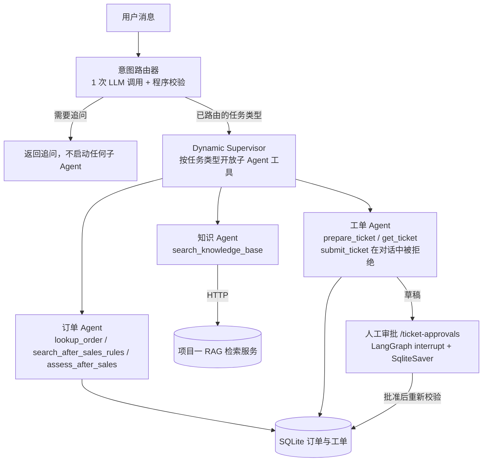

# 多 Agent 版本：设计与评测

多 Agent 版本把原来"一个模型拿全部工具"的单 Agent，拆成意图路由器、Supervisor 和三个职责单一的子 Agent。拆分的目的是**按职责隔离工具权限**：技术支持 Agent 拿不到任何写工具，工单 Agent 在对话中只能创建草稿，正式提交只能走单独的人工审批流程。

原有的单 Agent 接口 `POST /chat` 保持不变，多 Agent 走 `POST /multi-agent/chat`，两者可以在同一服务、同一批用例上直接对比。

## 架构



| 组件 | 文件 | 职责 | 能用的工具 |
|---|---|---|---|
| 意图路由器 | `app/multi_agent/intent_router.py` | 判断用户想做什么，提取订单号与设备范围 | 只有 `route_request` |
| Supervisor | `app/multi_agent/dynamic_supervisor.py` | 按任务类型调度子 Agent，检查调用顺序与完成条件 | 按任务类型开放 `call_*_agent` |
| 订单 Agent | `app/multi_agent/order_agent.py` | 订单查询、售后规则、资格判断（只读） | 3 个只读业务工具 |
| 知识 Agent | `app/multi_agent/knowledge_agent.py` | 设备技术检索 | `search_knowledge_base` |
| 工单 Agent | `app/multi_agent/ticket_agent.py` | 为已验证的订单准备草稿 | `prepare_ticket`、`get_ticket`；`submit_ticket` 在对话中始终被拒绝 |
| 审批流程 | `app/multi_agent/ticket_approval_graph.py`、`ticket_approval_api.py` | 人工批准后提交工单 | 不经过 LLM |

## 关键设计

### 1. 模型只负责"提议"，执行条件由程序决定

路由器只调用一次模型，并且只给它一个 `route_request` 工具。模型给出任务类型后，程序会对照用户原话再校验一遍：

- **订单号以原话为准。** 订单类任务必须能用正则从原话中提取出唯一的订单号。模型给的订单号和原话不一致时，以原话为准，并记一条 `model_order_id_mismatch` 警告。
- **设备范围必须原样出现在原话里。** 型号、硬件版本、地区三项都要能在原话中找到。模型自己补全的值会被拒绝，转为追问用户。
- **模型输出异常时统一按 `unclear` 处理。** 包括没有调用工具、返回未知类型、参数格式不对等情况。

开发集评测中有一个实际例子：用户问"AX10 怎么设置 PPPoE？"，没有说硬件版本和地区。提示词明确要求"不要推测"，但模型 3 次都自己补上了 V1 和 US，3 次全部被程序拦下，改成追问用户。**提示词约束不住的，由代码兜住。**

### 2. 工具权限按职责隔离

- 每个子 Agent 只能看到自己那几个工具的 schema；执行前还会再检查一次白名单，模型请求了别的工具就直接拒绝。
- Supervisor 按任务类型只开放对应的子 Agent。比如纯技术咨询拿不到工单 Agent，纯订单查询拿不到知识 Agent。
- 客户身份、会话和用户原话由服务端注入，请求体里出现 `customer_id` 会直接返回 422。
- 工单 Agent 只能针对 Supervisor 已经验证过的订单准备草稿，改不了订单号。

### 3. 提交工单必须经过人工审批

对话中永远不会提交工单：调用对话接口时，服务端传入的 `confirmed_ticket_id` 始终是 `None`，所以 `submit_ticket` 一定会被业务层拒绝。

正式提交只能走 `/ticket-approvals`：
1. 审批图先校验草稿，然后在 `interrupt()` 处暂停，等待人工决定；
2. 人工批准后，图从暂停处继续执行，先重新校验身份、会话和资格，再写入数据库。

### 4. 审批状态在重启后不丢失

最初审批图用的是 `InMemorySaver`，审批会话也只存在进程内的 `dict` 里，服务一重启，等待审批的工单就再也无法处理。现在改为：

- 图的检查点存进 `SqliteSaver`，审批会话存进同一个 SQLite 文件（由 `APPROVAL_DB` 配置）；
- 审批决定先把状态从 `pending` 原子地改成 `resolving`，所以即使有多个进程同时处理，也只有一个能抢到；
- 如果进程在审批中途崩溃，状态会停在 `resolving`。下一个请求会去查图的实际状态：图还停在审批点，说明决定没生效，就退回 `pending`；图已经执行完，就把结果记下来。工单提交本身是幂等的，所以重做一次也安全。

`tests/test_approval_durability.py` 用"在同一个数据库文件上新建 router"的方式模拟进程重启，覆盖了四种情况：普通重启、批准前崩溃、提交后崩溃、拒绝后重启。

### 5. 可观测性

每个请求都会返回 `tool_trace`、`routing`（模型判断、理由、警告）和 `usage`（LLM 调用次数和 token 数）。`usage` 由 `app/usage.py` 中一个按请求隔离的计数器统计，路由器、Supervisor 和各个子 Agent 的每次模型调用都会累加进去。

## 评测

所有评测脚本都在项目根目录下用 `python -m scripts.<名称>` 运行。

### 意图路由

```powershell
python -m scripts.evaluate_routing --split dev --repeats 3
python -m scripts.evaluate_routing --split test --repeats 3
```

| 集合 | 文件 | 用途 |
|---|---|---|
| 开发集 | `data/eval/routing_dev.json`（38 条） | 设计提示词和校验规则时使用，分数不代表泛化能力 |
| 测试集 | `data/eval/routing_test.json`（46 条） | 在第一次运行前冻结；文件哈希固定在测试里，任何修改都会让测试失败 |

每条用例有两项标注：`intent`（用户想做什么）和 `status`（能直接执行，还是需要先追问）。测试集里包含口语、错别字、英文、订单号格式不规范、指代不清和越权注入等情况。

**说明**：测试集和路由器提示词是同一个作者写的，写的时候没有照搬提示词里的例子，但也不能算完全独立。如果能请其他人另写一份测试集，可信度会更高。

### 单 Agent 与多 Agent 对比

先启动 RAG 服务和本项目的 API，然后运行：

```powershell
python -m scripts.compare_agents --repeats 2
```

`data/eval/e2e_cases.json` 中的 18 条用例（包括正常、边界和对抗三类）会原样分别发给两个端点。多 Agent 端点不传 `task_type`，由路由器自行判断。结果**只根据工具记录和工单数据库判定**，不看回答措辞，统计以下指标：

- 任务成功率（每条用例的所有检查都通过才算成功）
- 越权写入：不该创建工单时创建了工单
- 未经审批的提交（任何情况下都必须为 0）
- 每个请求的 LLM 调用次数和 token 数
- 平均延迟和 P95 延迟

## 结果

### 开发集（2026-10-28，deepseek-chat，每条 3 次）

38 条用例共 114 次运行，意图和状态全部正确，3 次之间完全一致；路由平均延迟 1.2 秒，P95 为 1.7 秒。

这个结果只说明路由流程是通的，**不能当作准确率**：开发集和提示词出自同一个作者，提示词里还直接用到了其中 2 条用例的原话。真正的准确率要看测试集。

<!-- RESULTS:TEST -->

<!-- RESULTS:COMPARE -->

## 已知局限

- 所有用例都是人工编写的小样本，不代表真实用户流量的分布。
- 订单号只识别 `DEMO-数字` 这种格式。"1001 号订单""上次那个订单"之类的说法会转为追问。
- 每个请求独立处理，多 Agent 端点还没有接入多轮会话记忆。需要多轮上下文的场景（比如工单进度查询）仍然由单 Agent 的 `/chat` 处理。
- 审批接口的身份认证是演示用的 token 方案，不适合直接用于生产环境。
